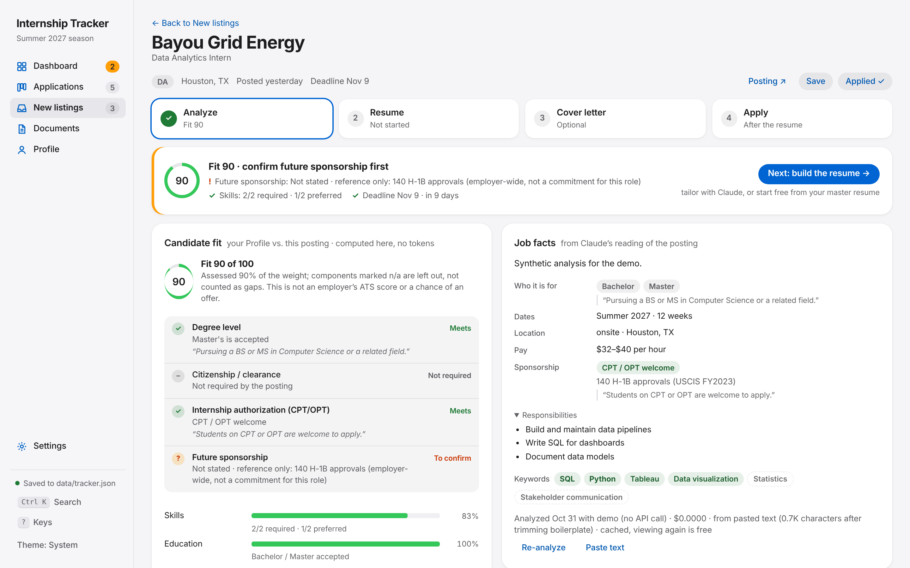
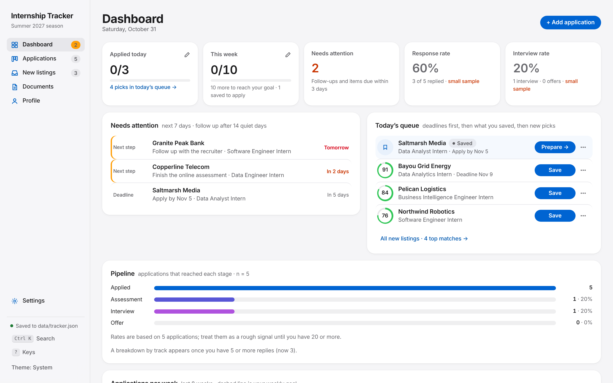
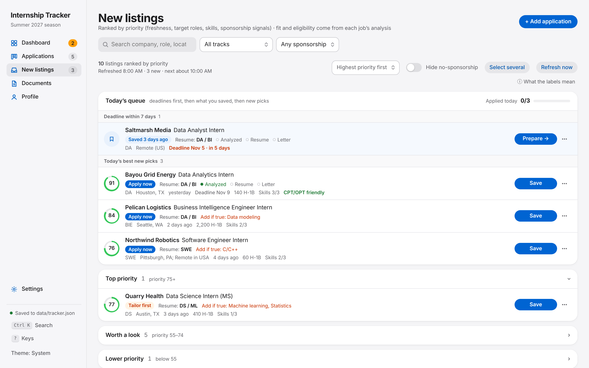
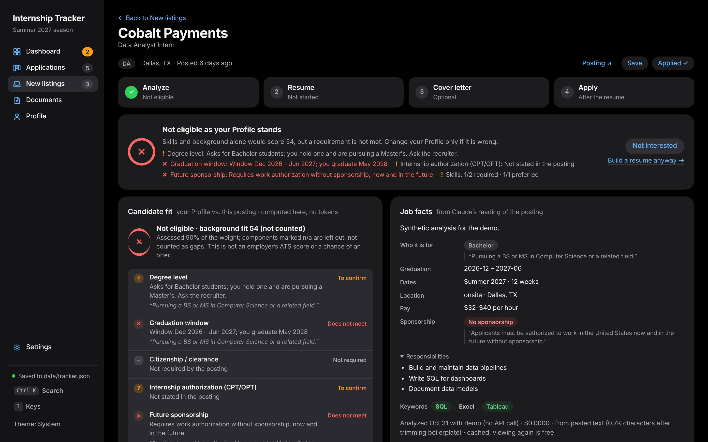
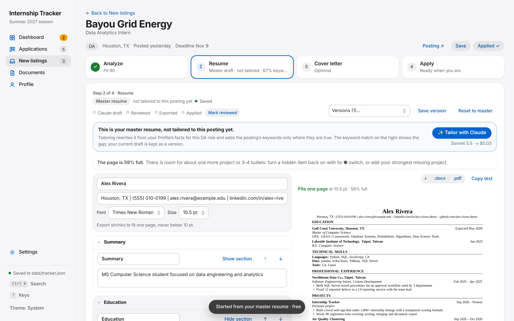

# Internship Application Tracker

A local-first web app for an internship search: it pulls new postings, ranks them, checks whether you are actually eligible, helps you build a truthful tailored resume and cover letter, and tracks every application from saved to offer. It runs on your own computer as one page plus a small Python server. There are no runtime dependencies, no account and no cloud database. Claude is optional and is only called when you press a button.



> **This is a local app, not a website.** The Python server reads and writes files on your computer, so it cannot run on GitHub Pages or any static host. Clone it and run it locally (below).

## What it does

| Step | What you get |
|---|---|
| **Find** | A scheduled refresh of the public [SimplifyJobs](https://github.com/SimplifyJobs) listings feed, filtered by your Profile (term, regions, degree level) and ranked by a transparent **listing priority**. A Chrome extension adds jobs from any other site. |
| **Decide** | Per job: **eligibility** (meets / does not meet / to confirm / not applicable, each with a quote from the posting) kept separate from **candidate fit** (your Profile against the posting). A failed requirement shows "Not eligible", whatever the other scores are. |
| **Prepare** | A resume editor with the exact export layout, the Profile fact behind every bullet, automatic fact checks, before/after versions, and a one-page fit you can undo. Cover letters are checked sentence by sentence against their sources. |
| **Send** | `.docx` and `.pdf` export. Each document records whether *this exact content* was reviewed and exported. |
| **Track** | Board and list views, deadlines, interview rounds, follow-ups, a calendar feed (`/calendar.ics`), a dashboard of what needs you next, backups and undo. |

| | |
|---|---|
|  |  |
|  |  |

*Screenshots use the synthetic demo data in `scripts/make_demo_data.py`. Every person, company and link in them is fictional.*

## Four scores, kept apart

Different questions get different numbers, and none of them claims to be an employer's ATS score or a chance of an offer.

| Score | Answers | Where it comes from |
|---|---|---|
| **A. Listing priority** | Which posting should I look at first? | Freshness, your target tracks and places, skills the posting names, sponsorship signals (`core.js` `score()`; the terminal mirrors it exactly, checked by `tests/test_parity.py`) |
| **B. Candidate fit** | How well does my real background match? | Your Profile against Claude's reading of the posting: skills, education, experience level, role, location, work authorization (`core.js` `fit()`) |
| **C. Keyword coverage** | Does the resume *text* use the posting's words? | Weighted literal coverage that ignores negated mentions ("no Python experience"). Rewording can raise it, but it never changes B. |
| **D. Resume quality** | Is the document well built? | Checklists from the Rice Center for Career Development resume and cover letter guides: one page, ≥ 10 pt, action verbs, quantified bullets and so on |

How fit and eligibility stay honest:

- **Unknown isn't scored.** A component that the posting or your Profile doesn't state is left out of the total. It gets no free points and isn't counted as a gap. The page shows how much of the weight it could assess. Below 60%, it shows "not enough information" instead of a number.
- **Eligibility is separate.** Degree level, graduation window, citizenship or clearance, CPT/OPT for the internship, and future sponsorship are each judged on their own, only from what your Profile says. Nothing is guessed from a name, school or nationality. H-1B counts are a dated, employer-wide reference only.
- **Inference is labelled.** Spelling variants match fully ("MS SQL Server" = "SQL Server"). A related skill gets half credit, is marked "inferred", and is never chained (PyTorch suggests deep learning, but not machine learning through it). `.NET` does not imply C#.
- **Fact checks are hints, not proof.** Bullets and letter sentences are flagged when they contain a number, year or tool that the cited Profile facts don't contain, a "Led…" claim the facts don't support, or "independently" where the facts describe team work. A sentence with no flag is unflagged, not verified.

Simplify publishes how its resume score and keyword matching work in general terms ([help article](https://help.simplify.jobs/help/articles/2175778-understand-resume-score-and-keyword-matching)), but not its formula. This project doesn't copy or claim to reproduce it.

## Run it

Requirements: **Python 3.8 or newer** (tested on 3.10 and 3.13 on Linux, and run daily on macOS). Nothing to install for the app itself.

```bash
git clone https://github.com/<you>/internship-tracker.git
cd internship-tracker
python3 server.py                      # opens http://127.0.0.1:8765, data in ./data
```

Options: `--port 9000`, `--data /path/to/folder`, `--no-browser`, `--no-fetch` (no background refresh).

### Try it with demo data (no API key, no cost)

```bash
python3 scripts/make_demo_data.py demo-data
IAT_AI_STUB=1 python3 server.py --data demo-data --no-fetch --port 8766
```

`IAT_AI_STUB=1` replaces every Claude call with a deterministic local answer and shows a banner on the page. The demo can't reach the paid API, and your real `data/` folder is never touched.

### Start automatically on macOS (optional)

A LaunchAgent with `RunAtLoad` and `KeepAlive` can keep the server running. Under launchd the server exits when its own code changes, so launchd restarts it with the new code.

```bash
launchctl kickstart -k gui/$(id -u)/com.<you>.internship-tracker   # restart
launchctl bootout   gui/$(id -u)/com.<you>.internship-tracker      # stop and unload
```

## Claude (optional)

Without Claude, everything except the four Claude buttons still works: listings, priority, tracking, the master resume, editing, export and checklists.

| Button | Default model | Sent to Claude | Typical cost |
|---|---|---|---|
| Analyze posting | Haiku 5.5 | posting text with EEO/benefits boilerplate removed (≤ 14K characters) | ≈ $0.001 |
| Tailor resume | Sonnet 5.5 | confirmed Profile facts (no contact details), resume rules, the job analysis, optional 6K-character excerpt | ≈ $0.04 |
| Cover letter | Sonnet 5.5 | the same Profile block, letter rules and your past letters (style only), the job analysis | ≈ $0.03 |
| Rewrite one bullet or paragraph | Haiku 5.5 | that text, its source facts, the job keywords | < $0.001 |

- **Prices.** Per million tokens: Haiku 5.5 $0.10 in / $0.50 out (prompts up to 100K tokens), Sonnet 5.5 $2 / $10, Opus 5.5 $4 / $20. Source: [platform.claude.com pricing](https://platform.claude.com/docs/en/about-claude/pricing), checked 2026-10-31. Costs shown in the app are **estimates** from token counts and this table, not invoices.
- **Budget.** The monthly budget is this app's own limit, not an Anthropic billing cap. Before every API call, recorded spend plus calls in progress plus the new call's worst case (the full output limit) must fit, so parallel calls can't overshoot. `0` means no limit.
- **Claude Pro via Claude Code** can run tailoring and letters on your plan instead of the API. It runs `claude -p --safe-mode --tools "" --no-session-persistence` in an empty temporary folder, without `ANTHROPIC_API_KEY`. **Falling back to the API is off by default**, because it bills per token. Turn it on in Settings if you want it.
- **Outputs are checked on the server.** Answers are reshaped to the expected structure, cited fact IDs must exist, and sentences are fact-checked. Posting text is treated as data, never as instructions.
- **Not verified.** These changes were tested with a stubbed Claude, not with a paid call.

## Your data

Everything lives in `data/` (git-ignored). Use `--data` to keep it somewhere else.

| Path | Contents |
|---|---|
| `tracker.json` | applications, settings, dismissed listings (written by the page; revision-checked, merged field by field when two tabs edit) |
| `listings.json` | the latest refresh (written only by the refresh, so it can never overwrite your edits) |
| `profile.json` | your facts; earlier versions in `backups/profile/` |
| `resumes/`, `letters/` | drafts, up to 25 versions per job, export records |
| `exports/` | every exported file, named `<your name>__<job>-<kind>-<content hash>`, so nothing is overwritten |
| `ai/` | posting text and analysis per job, usage ledger, model settings |
| `secrets.json` | API key (file mode 600); `ANTHROPIC_API_KEY` also works |
| `backups/` | tracker backups (all for 3 days, then daily for 60 days); `backups/corrupt/` keeps any file that could not be read |

Safety measures:
- The server listens on 127.0.0.1 only and checks the Host header (DNS rebinding) and the Origin (cross-site writes).
- It serves only the app's own files and follows posting links only to public http(s) addresses, including after redirects.
- A data file that can't be parsed is copied aside and **never overwritten**. Saves stop with an error until you restore a backup.
- Jobs from the Chrome extension are queued, and the server removes one from the queue only after `tracker.json` contains it.

## Tests

```bash
python3 -m unittest discover -s tests          # server, fetcher, Claude endpoints (stubbed), exports, regressions, JS/Python parity
node --test tests/core.test.js tests/regressions.test.js tests/fixtures.test.js
npm ci && npx playwright install chromium      # once, for the browser tests
tests/e2e/run.sh                               # full flow in Chromium on throwaway demo data with stubbed Claude
```

- `tests/fixtures/jobs.json` is a fixed set of synthetic postings: eligible, weak, ineligible for five different reasons, and too thin to score. Its labels are provisional judgments written during the review. Tests check verdicts, ranking order, score ranges, monotonicity and determinism.
- The end-to-end test runs this flow: search → save → analyze → tailor → edit → switch jobs mid-save → cover letter → review → export .docx/.pdf → edit after export → mark applied → reload.
- GitHub Actions (`.github/workflows/tests.yml`) runs all of these without secrets or network data.

## Architecture

```
internship-tracker.html  page shell          base.css   layout and components     apple.css  design tokens (light/dark), macOS refinements
app.js                   views, state, saves, dashboard, listings, applications
studio.js                Profile, job page (eligibility, fit), resume and letter editors, Documents, Claude settings
core.js                  priority score, track inference, fit and eligibility, keyword coverage, fact checks, 3-way merge
server.py                local HTTP server: files, revisions, backups, corrupt-file protection, calendar, refresh scheduler, endpoints
ai.py                    Claude calls (API / Claude Code / stub), prompts, output validation, budget, documents and export records
fetcher.py               feed download, Profile-driven gates, sentence-level sponsorship wording, dedup, terminal scoring
resume_export.py         .docx and .pdf from one layout; one-page fit; refuses characters the PDF fonts cannot show
clips.py, extension/     Chrome extension queue
jobs.py                  terminal: list / show / open / fetch
scripts/make_demo_data.py synthetic demo data       tests/   unit, regression, fixture, parity and browser tests
```

## Limitations

- **PDF fonts.** The PDF export uses the standard Times/Helvetica fonts. It refuses text they can't show (Chinese, Japanese, emoji) rather than printing "?". Use `.docx` for those. Accented Latin letters work in both formats.
- **Layout.** Line breaks match between the preview, `.docx` and `.pdf` because they share font metrics, but Word, Pages and other viewers may still differ slightly. Text in the PDF is selectable. No ATS compatibility is guaranteed.
- **Accessibility.** axe-core reports no WCAG 2.2 A/AA violations on the main pages at 1440, 768 and 390 px in light and dark mode. Keyboard paths were spot-checked. This is not a full WCAG audit, and Safari/WebKit was not tested in this review.
- **Data sources.** Listing data depends on the public SimplifyJobs feed and on each employer's page. Eligibility is only as good as the posting's wording and your Profile answers.
- **Outcome stats.** "Score vs. outcomes" is descriptive and doesn't predict interviews or offers.

## Licenses

- `fonts/`: Instrument Sans and IBM Plex Mono, SIL Open Font License (license files included). These fonts are no longer used by the page and can be removed.
- Dev only: Playwright (Apache-2.0).
- The project itself: **license not chosen yet** (see `docs/REVIEW.md`).
