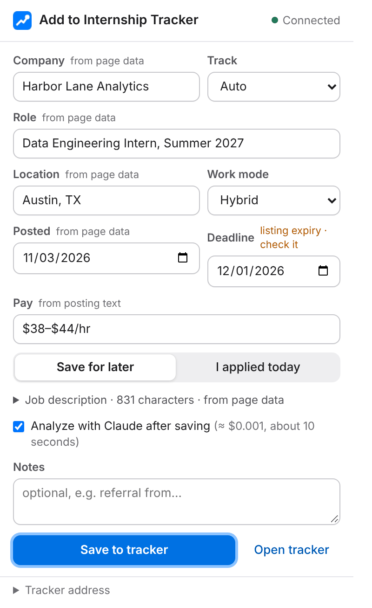

# Tracker Clipper

A Chrome extension that adds the job posting you are looking at to your local Internship Tracker in one click, from LinkedIn, Handshake, Workday, Greenhouse, Lever, Ashby or any company career site.

## Install

1. Start the tracker (`python3 server.py`, default http://127.0.0.1:8765).
2. Open `chrome://extensions`, turn on **Developer mode**, choose **Load unpacked** and select this `extension/` folder.
3. Open a job posting and click the extension, or press **Alt+Shift+J**.

If the tracker runs on another port, set it under **Tracker address** at the bottom of the popup.

## What it does

1. **Reads the page** you are viewing, in this order, and labels where each field came from:
   - structured page data (`JobPosting` JSON-LD, which most career sites publish);
   - site-specific readers for LinkedIn, Workday, Greenhouse, Lever and Ashby;
   - the page title, headings and the largest text block as a last resort, or the text you selected before opening the popup.
2. **Lets you check the fields:** company, role, location, work mode, posted date, deadline, pay, description and track. Fields it could not find, or guessed (such as a listing expiry used as a deadline), are highlighted.
3. **Warns about duplicates:** if the tracker already has this posting (same link, or same company and role), it says so instead of adding it twice.
4. **Saves** it as "Save for later" or "I applied today", and can ask Claude to analyze the posting right away (about $0.001).

The tracker queues each clip and removes it from the queue only after it is safely in `tracker.json`, so a clip is never lost if the page is closed.

## Permissions

| Permission | Why |
|---|---|
| `activeTab`, `scripting` | Read the posting in the tab you clicked on, only when you open the popup. No background access to other tabs or sites. |
| `storage` | Remember the tracker address and the "analyze after saving" choice. |
| `http://127.0.0.1/*`, `http://localhost/*` | Send the clip to your own tracker. Nothing is sent anywhere else. |

The server accepts clips only from the extension and its own page, and only on 127.0.0.1.

## Files

| File | Role |
|---|---|
| `manifest.json` | Manifest V3, permissions, shortcut |
| `extract.js` | Runs in the page: JSON-LD, site readers, fallbacks |
| `popup.html`, `popup.css`, `popup.js` | The form, duplicate check, save and status |
| `icons/` | The Waypoint mark at 16–128 px |

Tests: `tests/test_extension.py` (server side of the clip queue) and `tests/test_clips.py`.
